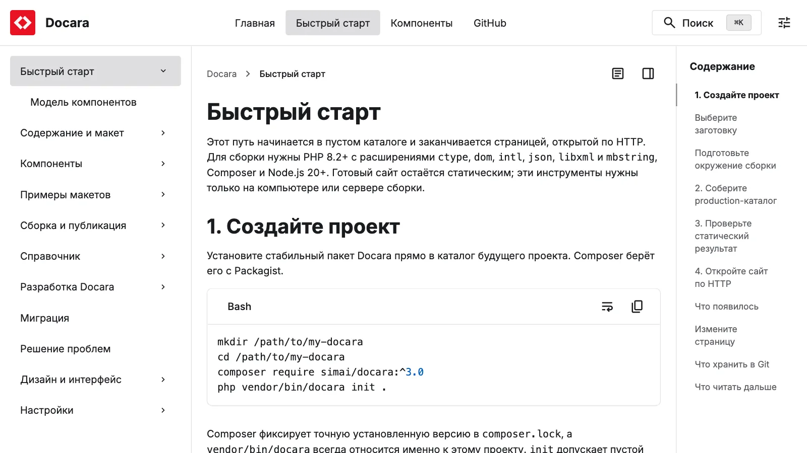
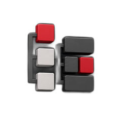
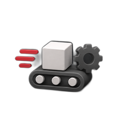
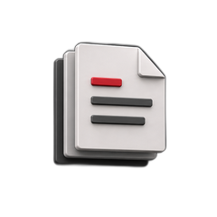
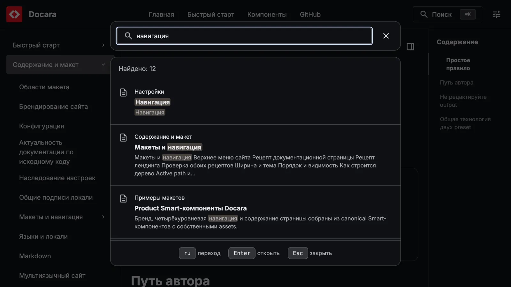
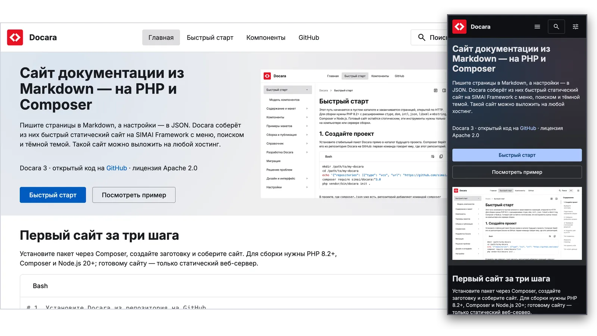

:::hero
# Сайт документации из Markdown — на PHP и Composer

Пишите страницы в Markdown, а настройки — в JSON. Docara соберёт из них
быстрый статический сайт на SIMAI Framework с меню, поиском и тёмной темой.
Такой сайт можно выложить на любой хостинг.

Docara 3 · открытый код на [GitHub](https://github.com/simai/docara) ·
лицензия Apache 2.0

[Быстрый старт](/start/)

[Посмотреть пример](/components/)


:::

## Первый сайт за три шага

Установите пакет через Composer, создайте заготовку и соберите сайт. Для сборки
нужны PHP 8.2+, Composer и Node.js 20+; готовому сайту — только статический
веб-сервер.

```bash
# 1. Установите Docara из репозитория на GitHub
echo '{"repositories": [{"type": "vcs", "url": "https://github.com/simai/docara.git"}]}' > composer.json
composer require simai/docara:^3.0

# 2. Создайте заготовку сайта
php vendor/bin/docara init .

# 3. Соберите сайт и откройте его в браузере
php vendor/bin/docara build production
php vendor/bin/docara serve production --no-build
```

Заготовки, проверка результата и публикация — в [полном быстром старте](/start/).

## Почему Docara

:::features
-  **Composer вместо npm.** Docara ставится и обновляется как обычный PHP-пакет: без npm-зависимостей и собственной темы, которую нужно поддерживать.
-  **Статический результат.** Сборка выдаёт готовые HTML, CSS и JavaScript. Их можно положить на GitHub Pages или любой веб-сервер: PHP и Node.js там не нужны.
-  **Дизайн-система SIMAI.** Интерфейс, светлая и тёмная темы и компоненты берутся из SIMAI Framework. Ошибку в вызове компонента сборка найдёт до публикации.
:::

:::showcase
## Полноценная документация из коробки

Меню разделов, поиск по сайту, хлебные крошки, содержание страницы и переходы
между материалами Docara строит сама. Читатель выбирает тему, размер шрифта и
ширину текста, а сайт может говорить на нескольких языках.

Как это настроить, рассказывает раздел
[«Макеты и навигация»](/authoring/layout-and-navigation/).


:::

:::showcase
## Лендинг продукта из тех же файлов

Эта страница — тоже Docara. Тот же Markdown и те же компоненты, только preset
`landing` убирает меню документации и оставляет первый экран, блоки и
призыв к действию.

Из каких блоков она состоит, показано на странице
[«Как собрана главная страница»](/landing/).


:::

## Примеры страниц

:::features
- **[Каталог компонентов](/components/).** Каждый компонент с живым примером, параметрами и кодом, который можно скопировать.
- **[Примеры макетов](/examples/).** Отдельные страницы с разными областями, шапками и наследованием настроек — вместе с исходными файлами.
- **[Компоненты проекта](/project-demos/).** Собственные компоненты сайта, подключённые без изменения Docara: конструктор команды установки и конфигуратор продукта.
:::

## Частые вопросы

:::details {view=lines}
### Чем Docara отличается от VitePress и Docusaurus?

VitePress и Docusaurus — проекты на npm: сайт собирается из JavaScript-пакетов,
а внешний вид задаёт тема, которую команда настраивает и обновляет. Docara
ставится через Composer, хранит содержание в Markdown и JSON, а интерфейс
берёт из SIMAI Framework. Она подходит командам, которые работают на PHP или
хотят документацию в общем стиле с продуктами SIMAI.
:::

:::details {view=lines}
### Какие требования?

Для сборки нужны PHP 8.2+ с расширениями `ctype`, `dom`, `intl`, `json`,
`libxml` и `mbstring`, Composer и Node.js 20+: команда `node` в `PATH` или путь
в переменной `DOCARA_NODE_BINARY`. Готовый сайт статический, ему нужен только
веб-сервер.
:::

:::details {view=lines}
### Можно ли сделать лендинг?

Да. Preset `landing` использует тот же Markdown, JSON и компоненты, но убирает
меню документации. Эта страница собрана именно так.
:::

:::details {view=lines}
### Можно ли добавить свой компонент?

Да. Сначала попробуйте обычный Markdown и готовые компоненты Docara. Если их не
хватает, подключите собственный компонент сайта по
[документированному контракту](/development/extensions/).
:::

:::details {view=lines}
### Как безопасно обновляться?

Команда `php vendor/bin/docara upgrade` готовит новую версию отдельно,
собирает и проверяет сайт и только затем применяет результат. Вернуться к
предыдущей версии можно командой `upgrade --rollback=latest`.
:::

:::promo
## Соберите первый сайт

Быстрый старт проведёт от пустого каталога до готовой страницы в браузере.

[Перейти к быстрому старту](/start/)
:::
