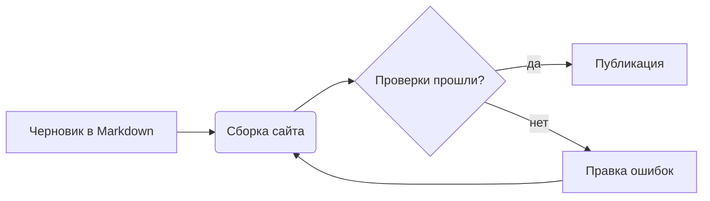

:::hero {layout=centered padding=2xl effect=chladni effect_settings='{"palette":"ink","speed":60,"transparency":25,"density":55}'}
# Документация из файлов — сайт, который собирается сам

Пишите страницы в Markdown рядом с проектом. Docara соберёт из них
статический сайт с поиском, меню и тёмной темой — на GitHub Pages или любом
хостинге.

[Начать](/ru/start/quick-start/)

[Документация](/ru/start/)
:::

## Три вещи, ради которых берут Docara

::::grid {columns=3 gap=4}
:::card
### Документация как код

```markdown
# Быстрый старт
Установите пакет и создайте сайт.

1. composer require simai/docara
2. docara init .
```

Текст — обычные файлы Markdown рядом с проектом. Правите файл — получаете
страницу. История — в GitHub, изменения — через pull request.
:::

:::card
### Готовый статический сайт

- :icon[check_circle] Сборка сайта
- :icon[check_circle] Проверка ссылок и поиска
- :icon[check_circle] Публикация на GitHub Pages

Сайт собирается прямо в GitHub и публикуется на GitHub Pages или любой
хостинг. Ни сервера, ни базы данных — только файлы, поэтому быстро, а на
GitHub Pages ещё и бесплатно.
:::

:::card
### Много готовых блоков

:badge[Шаги] :badge[Карточки] :badge[Вкладки] :badge[Схемы] :badge[Таблицы]
:badge[Уведомления] :badge[Первый экран] :badge[Колонки] :badge[Примеры]

Шаги, карточки, вкладки, схемы, таблицы, уведомления. Из них собираются не
только справочники, но и любые страницы, лендинги тоже.
:::
::::

## Как это работает

::::grid {columns=3 gap=4}
:::card
### 1. Пишете Markdown

```markdown
## Установка
Выполните в терминале:
`composer require simai/docara`
```

Страница — файл в папке `docs/`. Блоки — тоже Markdown: `:::steps`,
`:::tabs`, `:::card`.
:::

:::card
### 2. Отправляете в GitHub

```bash
git commit -m "Страница установки"
git push
```

`git push` или pull request — как с кодом.
:::

:::card
### 3. Сайт обновляется сам

```text
✓ Сборка   ✓ Проверка   ✓ GitHub Pages
```

GitHub Actions собирает и проверяет сайт и выкладывает его на GitHub Pages.
Если проверка не прошла, старая версия остаётся на месте.
:::
::::

Готовый файл процесса для GitHub Actions — в разделе
[«Сборка в CI»](/ru/build/ci/).

## Блоки, из которых собирается страница

Каждый пример ниже — живой: переключите вкладку и посмотрите Markdown, из
которого он собран.

:::::tabs
### Шаги

::::example {label="Шаги"}
```markdown
:::steps {current=2}
1. Создайте проект.
2. Добавьте страницы.
3. Опубликуйте сайт.
:::
```
::::

### Карточки

::::example {label="Карточки"}
```markdown
::::grid {columns=3}
:::card
#### Markdown

Страницы — обычный текст с заголовками и списками.
:::

:::card
#### JSON

Настройки сайта, разделов и страниц.
:::

:::card
#### PHP

Сборка и проверка — один пакет Composer.
:::
::::
```
::::

### Вкладки

::::example {label="Вкладки"}
````markdown
:::tabs
### Composer
```bash
composer require simai/docara:^3.0
```
### Архив
Скачайте архив и распакуйте его в пустой каталог.
### Результат
Готовый сайт появится в каталоге сборки.
:::
````
::::

### Схема

::::example {label="Схема"}
````markdown
:::diagram {title="Публикация страницы документации"}

:::
````
::::

### Таблица

::::example {label="Таблица"}
```markdown
| Команда | Что делает |
| --- | --- |
| `docara init .` | Создаёт заготовку сайта |
| `docara serve production` | Собирает сайт и открывает его в браузере |
| `docara verify-static` | Проверяет ссылки, файлы и поиск |
| `docara upgrade` | Обновляет Docara с проверкой и откатом |
```
::::

### Уведомление

::::example {label="Уведомление"}
```markdown
:::alert {type=info}
#### Полезная информация

Продолжайте работу в обычном порядке.
:::
```
::::
:::::

В документации Docara у каждого примера можно посмотреть код и проверить его
на ширине компьютера, планшета и телефона.

## Для команд и больших проектов

::::grid {columns=3 gap=2}
:::card
#### :icon[translate]{size=2 container=square variant=tonal scheme=primary} [Несколько языков](/ru/authoring/multilingual-site/)

Каждый язык — своя папка. Docara видит, какой перевод отстал от оригинала, и
может публиковать только актуальные страницы.
:::

:::card
#### :icon[search]{size=2 container=square variant=tonal scheme=primary} [Поиск без сервера](/ru/settings/search/)

Индекс строится вместе с сайтом. Поиск работает в браузере читателя и никуда
не отправляет запросы.
:::

:::card
#### :icon[dark_mode]{size=2 container=square variant=tonal scheme=primary} [Удобно читать](/ru/settings/reader-preferences/)

Светлая и тёмная тема, размер шрифта и ширина текста — читатель выбирает сам.
:::
::::

::::grid {columns=2 gap=2}
:::card
#### :icon[package_2]{size=2 container=square variant=tonal scheme=primary} [Установка через Composer](/ru/build/update/)

Обычный PHP-пакет `simai/docara`, версия закреплена в `composer.lock`.
Обновление — одной командой, при ошибке прежняя версия возвращается сама.
:::

:::card
#### :icon[menu_book]{size=2 container=square variant=tonal scheme=primary} [Подробная документация](/ru/start/)

Больше 130 страниц на русском и английском: каждый блок с живым примером,
настройки, сборка и публикация.
:::
::::

:::card
## ИИ-помощник — если хотите

Docara работает и без ИИ. Если вы пользуетесь агентом вроде Claude Code или
Codex, навык Docara помогает в трёх делах:

- :icon[translate] **Перевод.** Агент переводит страницы, а Docara проверяет,
  что форма страницы сохранилась и перевод не отстал.
- :icon[description] **Черновик из материалов.** Агент переносит README, папку
  `docs/` и заметки в страницы Docara.
- :icon[dashboard_customize] **Страница по описанию.** «Добавь страницу про
  установку с вкладками для каждой системы» — агент собирает её из готовых
  блоков.

[Как подключить навык](/ru/start/ai-agent/). Агент собирает и проверяет сайт,
выкладку решаете вы.
:::

## Частые вопросы

:::details {layout=lines}
### Нужны ли сервер и база данных?

Нет. Готовый сайт — статические файлы: HTML, CSS и JavaScript. PHP 8.2+,
Composer и Node.js 20+ нужны только там, где сайт собирается, — на вашем
компьютере или в GitHub Actions.
:::

:::details {layout=lines}
### Можно ли сделать не только документацию?

Да. Те же блоки собирают лендинг, страницу продукта или раздел с примерами;
для главной есть готовая заготовка `landing`.
:::

:::details {layout=lines}
### Как обновлять Docara?

Командой `php vendor/bin/docara upgrade`. Docara сначала собирает и проверяет
сайт на новой версии в отдельной папке и только потом заменяет старую; при
ошибке всё остаётся как было.
:::

:::details {layout=lines}
### Обязательно ли пользоваться ИИ?

Нет. Всё делается обычными командами и правкой файлов. Навык для ИИ-агента —
дополнительная возможность.
:::

:::details {layout=lines}
### Чем Docara отличается от VitePress и Docusaurus?

Docara ставится через Composer, как обычный PHP-пакет, а не из npm; поиск,
проверка ссылок перед публикацией и контроль переводов уже входят в неё.
:::

## Начните с одной фразы или трёх команд

:button[Поручить агенту]{href=/ru/start/ai-agent/} :button[Быстрый старт]{href=/ru/start/quick-start/ variant=outline scheme=on-surface}
