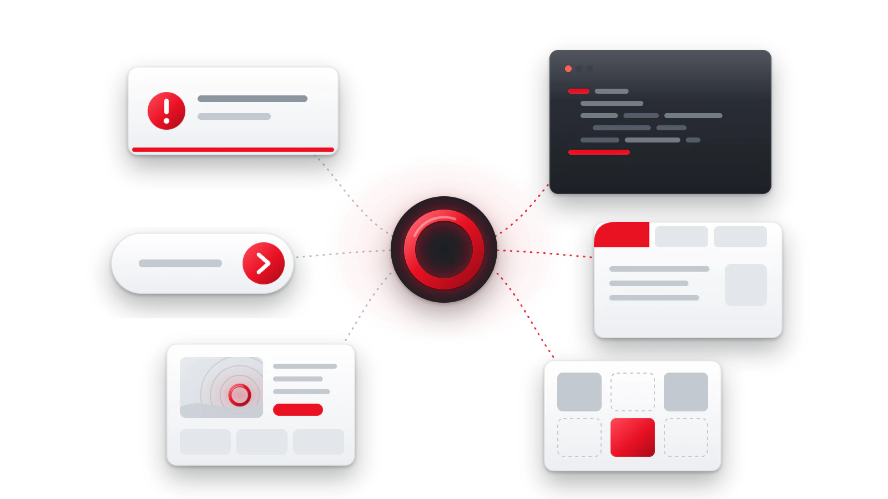
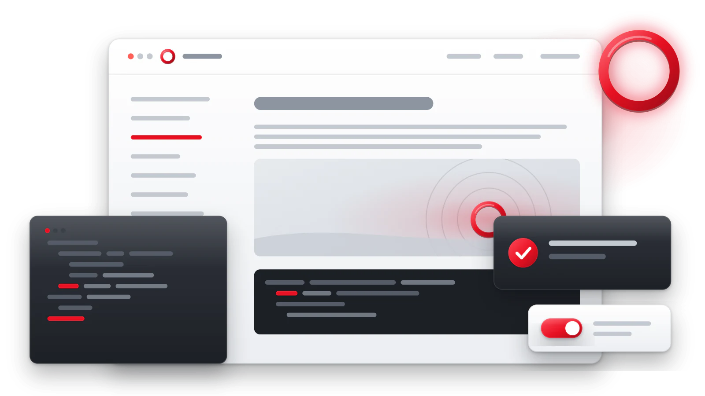
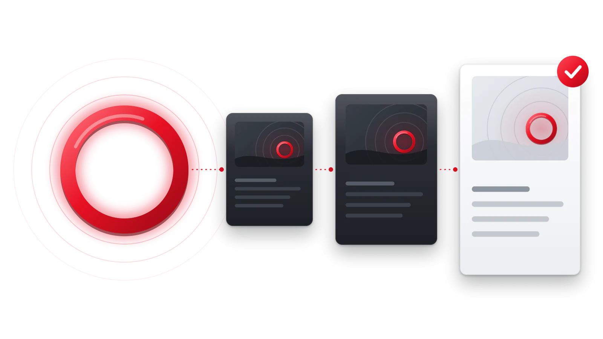

:::hero {layout=centered padding=2xl effect=text-search effect_settings='{"speed":80,"intensity":20,"density":40,"columns":3,"hits":4}'}
# Сайт документации из Markdown — на PHP и Composer

Пишите страницы в Markdown, а настройки — в JSON. Docara соберёт из них
быстрый статический сайт на SIMAI Framework с меню, поиском и тёмной темой.
Такой сайт можно выложить на любой хостинг.

Docara 3 · открытый код на [GitHub](https://github.com/simai/docara) ·
лицензия Apache 2.0

[Быстрый старт](/ru/start/quick-start/)

[Посмотреть пример](/components/)
:::

## Первый сайт за три команды

Установите пакет через Composer, создайте заготовку и соберите сайт. Для сборки
нужны PHP 8.2+, Composer и Node.js 20+; готовому сайту — только статический
веб-сервер.

```bash
# 1. Установите Docara
composer require simai/docara:^3.0

# 2. Создайте заготовку сайта
php vendor/bin/docara init .

# 3. Соберите сайт и откройте его в браузере
php vendor/bin/docara serve production
```

Заготовки, проверка результата и публикация — в [полном быстром старте](/ru/start/quick-start/).

## Что вы получаете

:::features
- :icon[package_2]{size=2 container=square variant=tonal scheme=primary} **Composer вместо npm.** Docara ставится и обновляется как обычный PHP-пакет. Сборка выдаёт готовые HTML, CSS и JavaScript: их можно выложить на GitHub Pages или любой веб-сервер без PHP и Node.js.
- :icon[palette]{size=2 container=square variant=tonal scheme=primary} **Дизайн-система SIMAI.** Интерфейс, светлая и тёмная темы и компоненты берутся из SIMAI Framework. Читатель сам выбирает тему, размер шрифта и ширину текста.
- :icon[account_tree]{size=2 container=square variant=tonal scheme=primary} **Меню из структуры файлов.** Разделы, хлебные крошки, содержание страницы и переходы к соседним материалам строятся сами. Подробнее — в [«Меню и разделах»](/ru/authoring/navigation/).
- :icon[search]{size=2 container=square variant=tonal scheme=primary} **Поиск без сервера.** Индекс собирается при сборке и работает в браузере читателя: не нужны ни база данных, ни внешний сервис.
- :icon[translate]{size=2 container=square variant=tonal scheme=primary} **Несколько языков.** Каждый язык — своя папка с Markdown, переключатель языка и `hreflang` появляются сами. Подробнее — в [«Многоязычном сайте»](/ru/authoring/multilingual-site/).
- :icon[verified]{size=2 container=square variant=tonal scheme=primary} **Проверка до публикации.** Ошибку в вызове компонента сборка найдёт сразу, а `verify-static` проверит страницы, ссылки, ресурсы и поиск. Подробнее — в [«Проверке результата»](/ru/build/verify/).
:::

## Посмотрите, как это выглядит

::::grid {columns=3 gap=2}
:::card


#### [Каталог компонентов](/ru/components/)

Каждый компонент — с живым примером, параметрами и кодом, который можно скопировать.
:::

:::card


#### [Примеры макетов](/ru/development/examples/)

Страницы с разными областями, шапками и наследованием настроек — вместе с исходными файлами.
:::

:::card


#### [Лендинг из тех же файлов](/ru/landing/)

Эта страница — тоже Docara: тот же Markdown, только без меню документации.
:::
::::

::::columns {ratio=2/1}
## Частые вопросы

:::details {layout=lines}
### Чем Docara отличается от VitePress и Docusaurus?

VitePress и Docusaurus — проекты на npm: сайт собирается из JavaScript-пакетов,
а внешний вид задаёт тема, которую команда настраивает и обновляет. Docara
ставится через Composer, хранит содержание в Markdown и JSON, а интерфейс
берёт из SIMAI Framework. Подробное сравнение — в [«Что такое Docara»](/ru/start/what-is-docara/).
:::

:::details {layout=lines}
### Можно ли сделать лендинг?

Да. Preset `landing` использует тот же Markdown, JSON и компоненты, но убирает
меню документации. Эта страница собрана именно так.
:::

:::details {layout=lines}
### Можно ли добавить свой компонент?

Да. Сначала попробуйте обычный Markdown и готовые компоненты Docara. Если их не
хватает, подключите собственный компонент сайта по
[документированному контракту](/ru/development/#как-развивать-возможности).
:::

:::details {layout=lines}
### Как безопасно обновляться?

Команда `php vendor/bin/docara upgrade` готовит новую версию отдельно,
собирает и проверяет сайт и только затем применяет результат. Вернуться к
предыдущей версии можно командой `upgrade --rollback=latest`.
:::

---

## Коротко о Docara

:::card
- **Версия:** Docara 3, лицензия Apache 2.0
- **Для сборки:** PHP 8.2+, Composer, Node.js 20+
- **Для сайта:** любой статический веб-сервер
- **Поиск по документации:** :kbd[⌘] + :kbd[K] или :kbd[Ctrl] + :kbd[K]
- **Для ИИ-помощников:** [llms.txt](https://docara.simai.io/llms.txt) — вся документация одним текстом

[Быстрый старт](/ru/start/quick-start/) · [Справочник](/ru/reference/)
:::
::::

:::cta
[Перейти к быстрому старту](/ru/start/quick-start/)
:::
